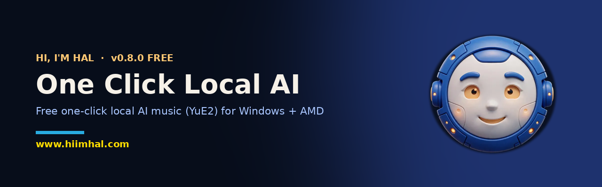

<p align="center">
  
</p>

<p align="center">
  <a href="https://github.com/HiImHal/one-click-local-ai/releases/latest"></a>
  <a href="https://github.com/HiImHal/one-click-local-ai/releases"></a>
  
  
</p>

<p align="center">
  <a href="https://github.com/HiImHal/one-click-local-ai/releases/download/v0.8.0/OneClickLocalAI-Setup-0.8.0-public.exe"></a>
</p>

<p align="center"><b><a href="https://www.hiimhal.com">Get the full version at hiimhal.com</a></b></p>

---

## What it is
A free one-click installer for Windows PCs with AMD graphics. It installs **YuE2**, which generates music locally: it writes full songs (vocals and music) from your lyrics, entirely on your own PC, with no NVIDIA GPU and no cloud.

In this free edition only the YuE2 music pack can be installed. The other packs are listed in the app as *Coming in a future version*.

## System requirements
| | |
|---|---|
| OS | Windows 11, 64-bit |
| PC | AMD Ryzen AI Max PC with Radeon 8060S / 8050S graphics (for example 96 GB or 128 GB mini PCs) |
| Driver | AMD Adrenalin 26.1.1 or newer |
| Graphics memory | AMD Variable Graphics Memory of at least 32 GB, 48 GB recommended (the installer checks this and shows you how to change it) |
| Disk / network | About 40 GB free disk space and an internet connection |

## Install
1. Download `OneClickLocalAI-Setup-0.8.0-public.exe` from the [Releases](https://github.com/HiImHal/one-click-local-ai/releases/latest) page (check it against [`SHA256SUMS.txt`](SHA256SUMS.txt) if you like).
2. Run it.
3. Open **One Click Local AI** from your Desktop.
4. Click **Install** on the **YuE2 music pack** and follow the setup window. You must accept the YuE2 licence. Downloads take a while; if interrupted, run it again and it continues where it stopped.
5. When done, open **YuE2 song generator (One Click)** from your Desktop. Songs are saved in `Music\YuE2-OneClick`.

> [!NOTE]
> The installer is not code-signed, so Windows SmartScreen shows **"Unknown publisher"** / "Windows protected your PC". Click **More info** > **Run anyway**. Some antivirus programs may also flag it; this is a false positive.

**Uninstall:** Start menu > One Click Local AI > Uninstall (your songs are kept).

## Verify your download
```
SHA-256  d21d83c456fbd4fe2fe0459e9d6c9c2680a3bc277b07eb12609c8b2f56a87c5d  OneClickLocalAI-Setup-0.8.0-public.exe
```
PowerShell: `Get-FileHash .\OneClickLocalAI-Setup-0.8.0-public.exe`

## Licences
- This app: see [LICENSE](LICENSE) (all rights reserved).
- YuE2 code and model weights are **CC BY-NC 4.0** (non-commercial use only) by the Multimodal Art Projection (M-A-P) team. They are downloaded from the original publishers at install time and are not included here. Songs you make are for personal, non-commercial use only.

---
<p align="center">Created by HiImHal · <a href="https://www.hiimhal.com">www.hiimhal.com</a></p>
